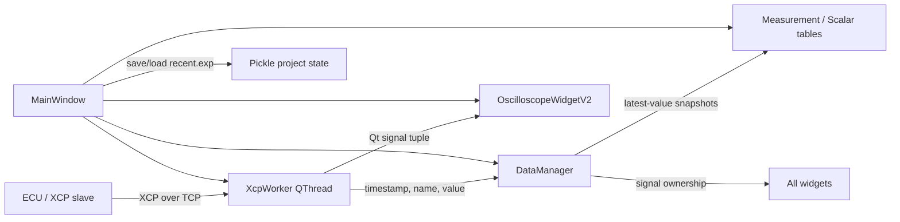

# ECU Instrumentation Suite (`py_gui_xcp`)

A PyQt6 desktop application for visualizing ECU measurements acquired through XCP DAQ. The application uses an MDI workspace containing live measurement tables and a multi-signal oscilloscope. Workspace layout and widget state are restored automatically from `recent.exp` when the application starts.

## Features

- XCP-over-Ethernet acquisition through pyXCP.
- Two configurable DAQ lists for 10 ms and 100 ms ECU event channels.
- Thread-safe latest-value storage in a shared `DataManager`.
- Multi-window MDI layout with scope, measurement-table, and scalar-table widgets.
- Real-time multi-signal plotting with per-signal Y views, visibility controls, zoom, pan, and auto-fit.
- Widget-level signal ownership and cleanup.
- Pickled project persistence for window layout and widget state.
- A2L measurement metadata loader in `xcp/a2l_manager.py` (currently a standalone helper, not yet connected to the GUI or DAQ-plan builder).

## Architecture



The main rules for this structure are documented in `PROJECT_RULES.md`.

### Data Flow

1. `MainWindow` creates one `XcpWorker` and one `DataManager`.
2. `XcpWorker` configures the DAQ lists declared in `xcp/XcpWorker.py` using pyXCP.
3. Incoming DAQ payloads are converted to `(timestamp, name, value)` tuples.
4. The worker emits `signal_ready` on a Qt signal, so connected GUI code executes on the GUI thread.
5. `DataManager` stores the latest value for each signal and tracks which widgets own it.
6. A 100 ms application timer asks visible widgets to refresh. Oscilloscope samples are also appended directly from its `on_xcp_data` slot.

## Project Structure

| Path | Responsibility |
| --- | --- |
| `pyxcp_gui_app.py` | Application entry point, MDI orchestration, acquisition controls, and project persistence. |
| `pyxcp_conf.py` | pyXCP transport configuration. Currently uses XCP over Ethernet at `localhost:21845` with TCP. |
| `asamint_conf.py` | ASAM project/A2L/HEX configuration used by ASAM-related tooling. |
| `xcp/XcpWorker.py` | pyXCP connection, DAQ list definition, sample extraction, and worker lifecycle. |
| `xcp/DataManager.py` | Thread-protected latest values, signal registration, and reference ownership. |
| `xcp/a2l_manager.py` | Query/search interface for ASAM A2L measurement metadata. |
| `ui/WidgetBase.py` | Shared table, context menu, signal ownership, refresh, and state behavior. |
| `ui/OscilloscopeWidgetV2.py` | Ring-buffered scope with shared X axis and independent per-signal Y scales. |
| `ui/MeasureTableWidget.py` | Live name/value/unit table with persistence. |
| `ui/ScalarTableWidget.py` | Measurement-table specialization populated with example scalar signals. |
| `ecu_hex/` | ECU executable, A2L, and launch helper supplied with the project. |
| `recent.exp` | Automatically saved/restored workspace state. |
| `PROJECT_RULES.md` | Engineering, threading, persistence, and validation rules. |
| `Project_BCU.exe.a2ldb` | Generated/working A2L parser database; do not edit manually. |

## Prerequisites

- Windows (the supplied ECU launch script and ASAM paths are Windows-specific).
- Python with PyQt6, pyqtgraph, NumPy, pyserial, python-can, pyXCP, ASAMint, and pya2l available.
- An ECU or XCP-capable simulator listening on the configured transport.
- For the bundled ECU target, Visual Studio/runtime requirements needed by `Project_BCU.exe`.

The checked-in `requirements.txt` is UTF-16 and currently lists the UI and serial/CAN packages. Verify that pyXCP/ASAM dependencies are installed in the selected environment before running the acquisition path.

## Setup

From the project directory on Windows PowerShell:

```powershell
py -m venv .venv
.\.venv\Scripts\Activate.ps1
pip install -r requirements.txt
```

Install any missing `pyxcp`, `asamint`, `pya2l`, or related project packages in the same environment. Then review these settings before connecting:

- `pyxcp_conf.py`: transport, host, port, protocol, and XCP options.
- `asamint_conf.py`: ECU A2L/HEX paths and project identity.
- `xcp/XcpWorker.py`: DAQ event numbers, addresses, extensions, names, and data types.

## Running

### 1. Start the ECU target or simulator

The bundled helper expects `Project_BCU.exe` to be available in `ecu_hex/`:

```bat
ecu_hex\run_Project_BCU.cmd
```

The application currently points pyXCP at `localhost` port `21845` over TCP.

### 2. Start the GUI

```powershell
.\.venv\Scripts\python.exe pyxcp_gui_app.py
```

Use **File** to create an oscilloscope, scalar table, or measurement table. Use **Options > Start** and **Options > Stop** for XCP acquisition. Right-click a widget table to add/remove rows or resize columns.

## Current DAQ Contract

`xcp/XcpWorker.py` currently defines these measurements directly in code:

| DAQ list | Event | Measurement | Address | Type |
| --- | ---: | --- | --- | --- |
| `DAQ_10MS` | 1 | `TestVar1_u8` | `0x10000000` | `U8` |
| `DAQ_100MS` | 2 | `TestVar2_u8` | `0x10000001` | `U8` |

The A2L file is not currently used to generate these DAQ lists. If names, addresses, types, or event channels change in the ECU, update the DAQ definitions and any persisted widget signal names together.

The worker emits host-relative timestamps from `time.perf_counter()`. ECU timestamp fields received by `on_daq_list` are not used for plotting at present.

## Persistence

On normal close, `MainWindow` saves workspace state to `recent.exp` with Python `pickle`. Saved data includes main-window layout plus oscilloscope, measurement-table, and scalar-table state. It intentionally excludes transient samples.

Only load `recent.exp` from a trusted source. Pickle files can execute code during deserialization. Startup loading currently ignores load errors silently to keep the GUI usable when state is missing or incompatible.

## Validation

Compile changed Python modules before committing:

```powershell
.\.venv\Scripts\python.exe -m py_compile pyxcp_gui_app.py `
  xcp/XcpWorker.py xcp/DataManager.py xcp/a2l_manager.py `
  ui/WidgetBase.py ui/OscilloscopeWidgetV2.py `
  ui/MeasureTableWidget.py ui/ScalarTableWidget.py
```

For GUI tests without a display:

```powershell
$env:QT_QPA_PLATFORM = "offscreen"
.\.venv\Scripts\python.exe -m pytest
```

There is currently no checked-in automated test suite. Test connection, shutdown, ownership, state round-trips, empty selections, duplicate names, unknown signals, and malformed project data when changing those paths.

## Known Constraints and Follow-Up Areas

- DAQ measurements are hard-coded instead of derived from A2L metadata.
- `DataManager.ingest_signal()` assumes the incoming signal was registered; unknown names can raise a `KeyError`.
- The scalar table starts with example signals that are not part of the active DAQ plan.
- `DataManager.get_signal_data()` returns live internal objects rather than a detached snapshot.
- Project persistence uses trusted-local Python pickle rather than a versioned safe format.
- `pyxcp_conf.py` and `asamint_conf.py` contain machine-specific networking/paths and must be reviewed per workstation.
- The scope worker and A2L helper should have focused integration tests before broader acquisition changes.

## AI Agent History

This section is the handoff log for coding agents. Add a new entry after each substantive AI-assisted change. Keep entries factual: date, agent/model, files touched, behavior changed, validation performed, and any unresolved risk. Do not record secrets, credentials, or raw ECU data.

### 2026-11-20

- **Agent:** GitHub Copilot (MAI Code 2)
- **Task:** Review the repository and create the initial project README for AI-assisted handoffs.
- **Files changed:** `README.MD`.
- **Summary:** Documented architecture, XCP data flow, module ownership, setup/run instructions, DAQ assumptions, persistence behavior, validation guidance, and known constraints.
- **Validation:** Compared the documentation against the current Python sources, pyXCP/ASAM configuration, launch script, dependency file, and recent Git history.
- **Open items:** Automated tests are not currently present; A2L metadata loading is not connected to DAQ plan generation; checked-in requirements may not cover all imported packages.

### History Entry Template

```markdown
### YYYY-MM-DD

- **Agent:** Name / model
- **Task:** Short description
- **Files changed:** Paths
- **Summary:** Behavior and documentation changed
- **Validation:** Commands/tests run and their outcome
- **Open items:** Remaining risk, follow-up, or "None"
```
